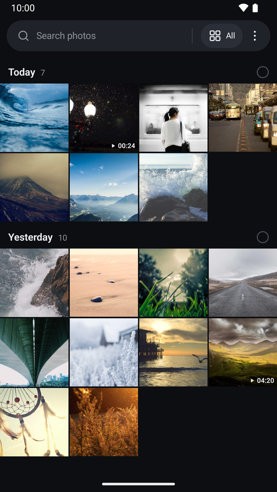
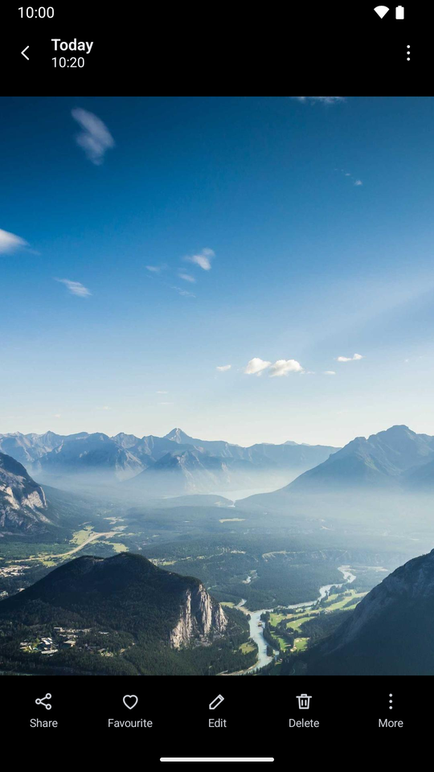
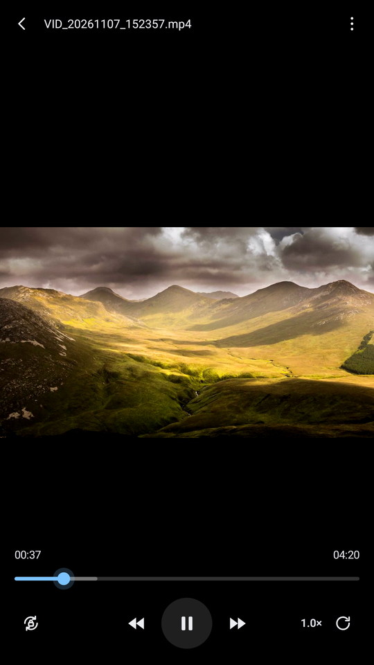

# Gallery

**Tired of AI feature and slow photo loading?**

A plain, fast photo and video gallery for Android. No AI, no cloud, no accounts, no ads, and it doesn't even ask for internet access. It opens on your photos, shows every one of them, and gets out of the way.

<p align="center">
  
  
  
</p>

<sub>Sample photos in the screenshots are from <a href="https://picsum.photos">Lorem Picsum</a>.</sub>

## Why it exists

- The stock gallery hangs on "loading" right after you take a photo. Here the new photo is already in the grid when you switch over.
- Google Photos doesn't show every image. This app looks in every folder (WhatsApp, Telegram, Download, all of it), including files Android's own media index never picked up.

## What it does

**Fast**
- Opens straight onto thumbnails. The index lives in a small local database and updates in the background, so a rescan never blocks the screen.
- Built for libraries of 100k+ items, lots of them videos.

**Sees everything**
- With "All files access" it finds every image and video on internal storage and SD cards.
- Folders with a `.nomedia` file or a dot-name (stickers, caches) are found but kept under *Hidden folders*. One tap shows them.

**Timeline and folders**
- *All* view grouped Today, Yesterday, then by date. Pinch for 2 to 6 per row. The fast-scroll handle only appears while you scroll, so you can't hit it by accident.
- *Folders* view with same-size covers, pinned Favourites / Camera / Screenshots, and a "+ New folder" that makes a real folder on the phone.
- Hold a photo and drag to select a whole range.
- Search by file name, folder name or a date ("oct 2026", "yesterday").
- Sort by date taken, date modified, name, size or length (videos).

**Delete that asks**
- Every delete asks: Recycle bin (kept 30 days, with undo) or gone for good. Tick "Remember my choice" to stop asking.
- No Android confirmation popup on every delete or move.

**A proper video player**
- Hold anywhere for 2×. While holding, slide up for 0.5× or slide down to lock 2×.
- Double-tap the sides to skip 5 or 10 s. Speed list from 0.25× to 2×.
- Pinch to zoom into the video (up to 5×) while it plays.
- Long videos are handled properly: hours on the clock, scrubbing with preview frames, and it resumes where you left off.
- Rotation lock and a manual rotate button.

**Photo viewer**
- Pinch or double-tap to zoom, swipe for the next one.
- Swipe up for the details: dates, size, resolution, camera settings and location.

## Install

- Android 11 or newer (API 30+), built for Android 16 (API 36).
- It isn't on the Play Store, because Google Play restricts "All files access" for galleries.
- Download the APK from [Releases](https://github.com/Kanorin-chan/gallery/releases/latest) and open it on your phone.
- On first run it explains, on one screen, why it needs *All files access* and *Media management*, then opens Android's settings page for each.

## Build

You need JDK 21 and the Android SDK (platform 36).

```sh
./gradlew assembleRelease      # APK in app/build/outputs/apk/release/
./gradlew testDebugUnitTest    # unit + Robolectric UI tests, no device needed
```

Release builds are signed with your local debug key, so each new build installs over the last one on the same machine. On Windows, `scripts/gradle.ps1 <tasks>` runs Gradle with Android Studio's bundled JDK.

## Under the hood

Kotlin, Jetpack Compose, Room, Paging 3, Media3 (ExoPlayer), Coil 3 and DataStore.

The design is in [`docs/superpowers/specs/`](docs/superpowers/specs/) and the current state is in [`docs/STATUS.md`](docs/STATUS.md).

## Status

Version 0.1.1. It's early, but it's in daily use on a RedMagic 8 Pro. Only a dark theme for now. Tagging and tag search are planned.

Built with [Claude Code](https://claude.com/claude-code).

## License

[MIT](LICENSE): free to use, change and share.
